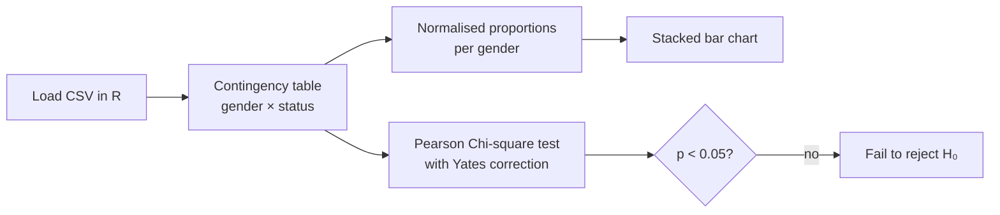
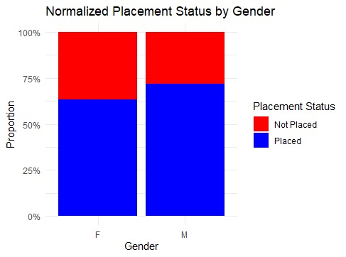
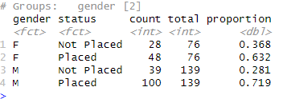

<div align="center">

# 🎓 Gender Disparities in Graduate Job Placement

**A statistical study of whether gender affects campus placement outcomes — Chi-square test, proportion analysis and R visualisation**

[](#-reproduce-the-analysis)
[](#-visual-evidence)
[](#-results)
[-eb6834)](#-team)

</div>

---

## 📌 Research question

> **Is there a difference in the proportion of students placed vs not placed between male and female students?**

| | Hypothesis |
|---|---|
| **H₀** | Placement status is independent of gender (equal proportions). |
| **H₁** | Placement proportions differ by gender. |

Significance level: α = 0.05

## 📊 Data

`Dataset_Placement_Data_Full_Class.csv` — 215 MBA students, 15 variables (school, higher-secondary, degree and MBA percentages, specialisation, work experience, employability-test score, placement status, salary). Anonymised; no personally identifiable information.

| Gender | Placed | Not placed | Total | Placement rate |
|---|:---:|:---:|:---:|:---:|
| Female | 48 | 28 | 76 | **63.2%** |
| Male | 100 | 39 | 139 | **71.9%** |
| **All** | 148 | 67 | 215 | 68.8% |

## 🧪 Method



An optional logistic regression (placement ~ gender) was also fitted to confirm the direction and size of the effect.

## ✅ Results

| Statistic | Value |
|---|---|
| χ² | 1.3818 |
| Degrees of freedom | 1 |
| **p-value** | **0.2398** |
| Decision | Fail to reject H₀ |

**Conclusion:** the 8.7-point gap in placement rate between male and female students is **not statistically significant** in this sample. Placement programmes should look first at other factors — academic performance, work experience and specialisation — rather than gender-specific interventions.

## 📈 Visual evidence

<p align="center">
  
  
</p>

## 🗂 Repository structure

```text
Project_Team_Research/
├── Dataset_Placement_Data_Full_Class.csv     # dataset (215 rows)
├── Hypothesis_Test/
│   ├── Hypothesis_Testing_Code.txt          # R session: contingency table + Chi-square test
│   └── Hypothesis_Test.Rproj
├── R_Visualization/
│   ├── Rcode.txt / Visualization_Code_Update.txt   # ggplot2 code
│   ├── Normalized_Placement_Status_By_Gender.jpg
│   └── ProportionVisualization.PNG
├── Final Report                              # written report (plain text)
├── A-64 Team Research and Development Presentation Slide.pptx
└── commit_report.txt                         # git log used as evidence of collaboration
```

## ▶️ Reproduce the analysis

```r
install.packages(c("ggplot2", "dplyr", "tidyr"))

df <- read.csv("Dataset_Placement_Data_Full_Class.csv")
tab <- table(df$gender, df$status)
prop.table(tab, margin = 1)   # placement rate by gender
chisq.test(tab)               # X-squared = 1.3818, df = 1, p-value = 0.2398
```

The full R sessions are in `Hypothesis_Test/Hypothesis_Testing_Code.txt` and `R_Visualization/Rcode.txt`.

## ⚠️ Limitations

- Small sample (76 female students), so the test has limited power to detect a modest effect.
- Single institution and cohort; results may not generalise.
- Gender is tested on its own; confounders such as degree percentage or work experience are not controlled for.

## 👥 Team

Module **7COM1079 — Team Research and Development Project**, University of Hertfordshire · Group A64

S M Mahamudul Hasan · Mahmud Hyader · Umma Tasmim · Md. Mostafizur Rahaman Anik · Md Sahidul Islam Chowdhury

[](https://hasansm.com)
[](https://www.linkedin.com/in/sm-mahamudul-hasan)
